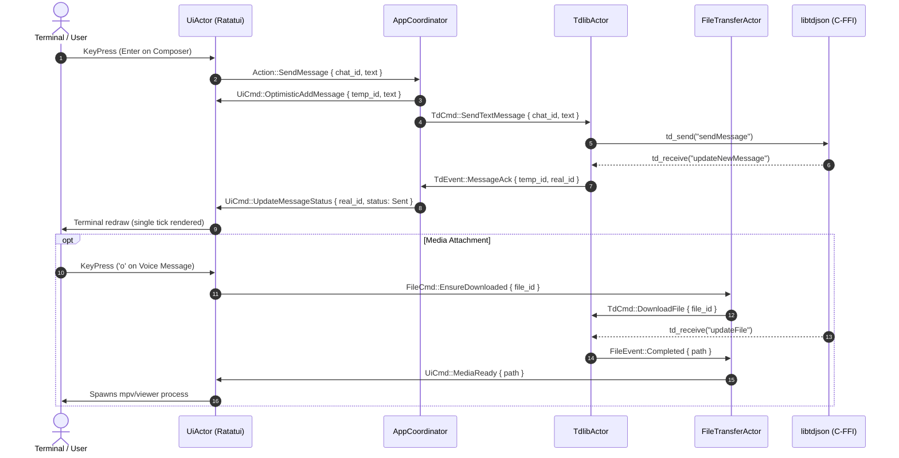

# Architecture: TgTui (a rebuild of Telegram Desktop's core features)

## Stack

| layer | choice | why |
| --- | --- | --- |
| language | Rust (2024 edition) | Zero-cost abstractions, memory safety, exceptional async performance, and native C-FFI integration |
| interface (TUI) | Ratatui + crossterm | Industry-standard terminal UI framework; rich widget primitives, double-buffering, cross-platform terminal support |
| concurrency | Tokio (Actor Model) | Asynchronous runtime with actors communicating over typed `mpsc` and `broadcast` channels; prevents UI lockups |
| network / protocol | TDLib (`libtdjson` C-FFI) | Official Telegram client core; implements MTProto 2.0, end-to-end encryption, automatic reconnection, and file chunking |
| persistence | TDLib SQLite + `config.toml` | TDLib securely encrypts and persists chats/messages locally; TOML stores user keybindings, UI themes, and API credentials |
| media playback | ASCII Waveforms + External Viewers | Lightweight audio visualization in terminal; instant spawn of external viewer (`mpv`, system image viewer) via hotkey |

## Schema

Tables: 9 (see [replica/schema.sql](file:///d:/TgTui/replica/schema.sql)).
Access rules: Client-side local data storage managed by TDLib with optional local cache checks.

```sql
-- Core entities defined in replica/schema.sql:
-- 1. users: user profile, status, badges
-- 2. chat_folders: custom folder filters
-- 3. chats: dialog entries, unread badges, pin order
-- 4. media_attachments: local files, audio waveforms, download statuses
-- 5. messages: chat history, replies, forward origins, delivery flags
-- 6. message_entities: rich markdown spans (spoilers, code, mentions)
-- 7. message_reactions: emoji counters and user choices
-- 8. folder_chats: many-to-many folder assignments
-- 9. local_preferences: user keybindings, theme colors, UI states
```

## API (Actor Messages & TDLib RPC)

Communication is organized around Tokio Actors sending typed command messages and listening to TDLib updates.

| Actor / RPC Call | does | who | input | output | flow |
| --- | --- | --- | --- | --- | --- |
| `AppCoordinator::Init` | Bootstraps configuration and launches actors | Main entry | `config.toml` path, API keys | `Ok(())` | F01 |
| `Tdlib::SetAuthenticationPhoneNumber` | Submits user phone number | `TdlibActor` | `phone_number: String` | `UpdateAuthorizationState` | F01 |
| `Tdlib::CheckAuthenticationCode` | Verifies SMS/Telegram OTP code | `TdlibActor` | `code: String` | `UpdateAuthorizationState` | F01 |
| `Tdlib::CheckAuthenticationPassword` | Verifies 2FA Cloud Password | `TdlibActor` | `password: String` | `UpdateAuthorizationState(Ready)` | F01 |
| `Tdlib::LoadChats` | Requests next batch of dialogs | `TdlibActor` | `limit: i32, chat_list: ChatList` | `UpdateChatPosition`, `UpdateNewChat` | F02 |
| `Ui::RenderDialogList` | Draws two-column dialog view | `UiActor` | `Vec<ChatSummary>, active_idx` | Terminal frame | F02 |
| `Tdlib::SendMessage` | Sends plain or formatted text | `TdlibActor` | `chat_id, text, reply_to_id` | `UpdateNewMessage (Pending)` | F02, F03 |
| `Tdlib::EditMessageText` | Edits previously sent message | `TdlibActor` | `chat_id, message_id, new_text`| `UpdateMessageContent` | F04 |
| `Tdlib::DeleteMessages` | Deletes message for self or all | `TdlibActor` | `chat_id, vec![message_id], revoke` | `UpdateDeleteMessages` | F04 |
| `FileTransfer::DownloadMedia` | Asynchronously pulls media to cache | `FileTransferActor` | `file_id, priority` | `FileProgress(percent)`, `FileReady(path)` | F05 |
| `Ui::SpawnExternalViewer` | Launches system viewer / mpv | `UiActor` | `local_file_path: PathBuf` | `ProcessId` | F05 |
| `Tdlib::ForwardMessages` | Forwards messages with privacy flag | `TdlibActor` | `from_chat, to_chat, msg_ids, hide_author` | `Vec<Message>` | F06 |
| `Tdlib::SearchChatMessages` | Searches text inside active chat | `TdlibActor` | `chat_id, query, filter, offset` | `FoundMessages` | F07 |
| `Tdlib::SetChatDraft` | Synchronizes draft in active chat | `TdlibActor` | `chat_id, draft_text, reply_to_id` | `Ok` | F02 |

### Actor Message Pipelines



## The parts that bite

- **Flood Wait & Rate Limits**: Telegram rigorously throttles rapid requests (`420 FLOOD_WAIT_X`). `TdlibActor` must intercept `error.code == 420` and emit a countdown timer to `UiActor` without dropping pending actions.
- **Terminal Resize (`SIGWINCH`)**: Rapid window resizing breaks naive TUI layouts. Ratatui requires handling `Event::Resize(w, h)`, clearing double buffers, and recalculating wrapped text line heights for chat history.
- **UTF-8 & Unicode Grapheme Clustering**: Emoji, zero-width joiners (ZWJ), flags, and Cyrillic text take variable terminal cell widths (1 or 2 columns). Using `unicode-width` and `unicode-segmentation` is mandatory to prevent text clipping and cursor misalignment.
- **Optimistic UI vs Server State**: When sending a message, render it immediately with a temporary local ID and a `Pending` (clock) icon. Match the server's `updateNewMessage` ACK to replace the temp ID with the real `message_id`.
- **C-FFI Lifetime & Concurrency**: `libtdjson` functions (`td_json_client_create`, `td_json_client_receive`, `td_json_client_send`) must run on a dedicated OS thread or Tokio blocking thread (`spawn_blocking`) to avoid stalling the Tokio event loop.

## Build order

### Milestone 1: Vertical Slice (The Core Loop)
- **Scope**: S01 (Auth: Phone + OTP + 2FA), S02 (Two-column Shell: Dialog list + Chat history), S03 (Read messages stream), S04 (Compose & send text message).
- **Deliverables**:
  - Rust workspace setup with `ratatui`, `tokio`, `crossterm`, `libtdjson` bindings.
  - Interactive auth flow in terminal.
  - Real-time dialog list rendering and chat switching.
  - Text messaging with optimistic UI ticks (`clock` -> `✓` -> `✓✓`).

### Milestone 2: Must-Haves (Rich Text & Message Actions)
- **Scope**: S04 (Composer formatting: bold, italic, code), S07 (Context Menu: Reply, Edit, Delete for everyone, Forward).
- **Deliverables**:
  - Markdown parser converting Telegram formatting entities into Ratatui `Span` styles.
  - Reply banners above composer with jump-to-quote navigation.
  - In-place message editing and deletion.

### Milestone 3: Should-Haves (Media, Folders & Search)
- **Scope**: S02 (Folder sidebar tabs), S06 (Media metadata & ASCII waveform player), S10 (In-chat search).
- **Deliverables**:
  - `FileTransferActor` integration for downloading voice notes and photos.
  - ASCII audio waveform synthesis (` ▂▃▅▆▇`) with `mpv` audio player launcher.
  - Full-text search inside active chat history with `Ctrl+F`.
  - Chat folder switching via numeric hotkeys (`Alt+1`, `Alt+2`).

### Milestone 4: Polish & Customization
- **Scope**: S12 (Settings / `config.toml` editor), Custom color themes, Vim-like keybindings (`j`/`k` navigation, `i` to insert, `Esc` to normal mode).
- **Deliverables**:
  - TOML configuration loader and hot-reload.
  - Vim navigation mode for power users.
  - SOCKS5 / MTProto proxy support.
